# Qreep

> A Quickshell-based desktop creature that is odd, small, memorable, slightly cursed, but friendly enough to become mine.

Qreep is my personal desktop shell for Hyprland.

It started as a Waybar-shaped learning project: one bar, a few pills, and the innocent belief that it would remain small. It has since grown into the place where I build the desktop surfaces I actually want to use — without trying to become a desktop environment, a universal framework, or a cathedral made entirely of QML.

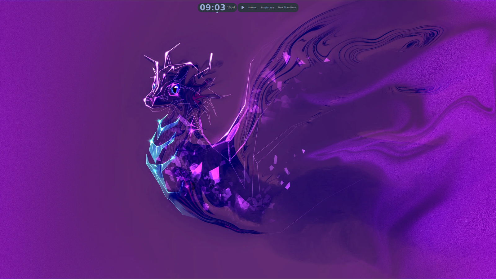


https://github.com/user-attachments/assets/639899a5-bea6-46c3-b4e3-f87f33290a33


*A quiet desktop until I ask it to do something.*

## Why this creature exists

I like using things, but I also like understanding how they work.

Qreep is not an argument against Waybar, AGS, or somebody else's idea of a good desktop. Those projects helped me get here.

This one exists because learning is fun, experimentation is useful, and sometimes the best way to understand a shell is to build your own slightly questionable version of it.

It is the continuation of many ideas from my older AGS setup, now rebuilt around Quickshell and allowed to grow in a direction that feels more mine.

## What lives here

### The bar

The daily visible part of Qreep includes:

- Hyprland workspaces;
- clock and calendar;
- timer and countdown pill;
- POTATO fasting progress;
- MPRIS media controls;
- network, keyboard layout, volume, battery, and power controls;
- Vitals: small CPU, temperature, fan, battery, and disk gauges you switch on as needed;
- a system tray for the apps that insist on one;
- a launcher button (it opens KIP) and monitor-profile controls;
- update checking;
- Borg backup state and progress;
- a Qreeper compass, only while a Qreeper session is running.

The bar can run in `reserved`, `overlay`, or `collapsed` mode. Individual pills may also be enabled or expanded independently, because apparently even a bar can have moods.

#### Workspaces

The workspace pill shows the active workspace, occupied workspaces, and the windows living inside them.

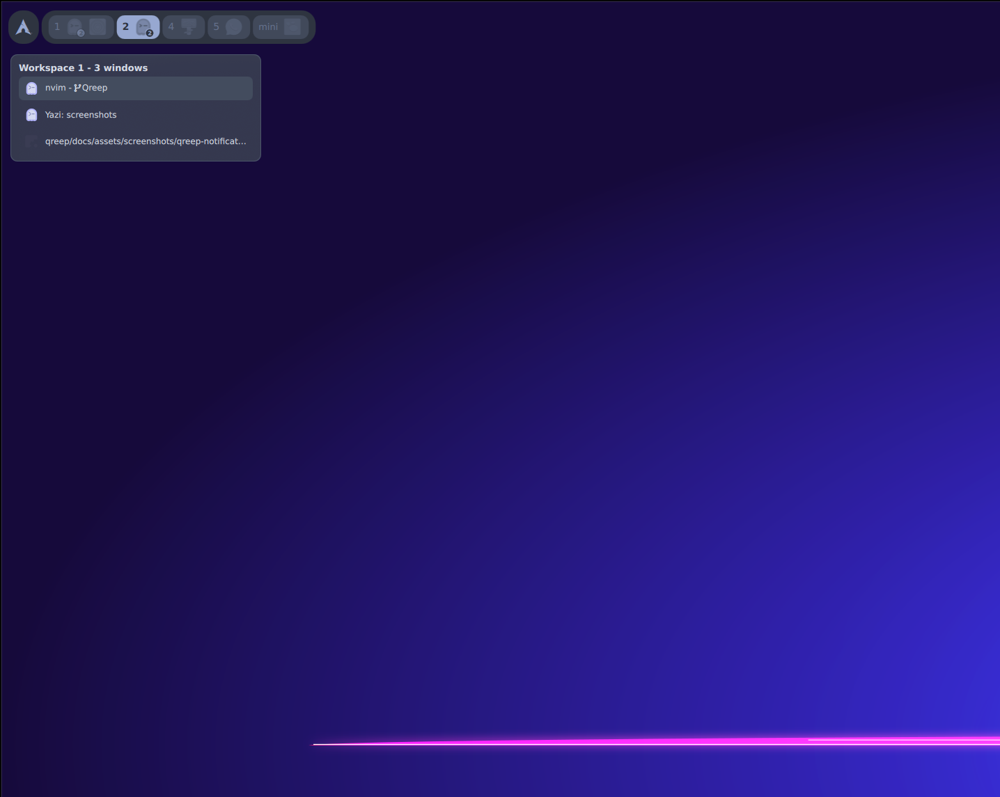

Workspace switching:

<https://github.com/user-attachments/assets/69f106ff-27a7-43da-b368-63fe93683370>

Workspace windows and taskbar behaviour:

<https://github.com/user-attachments/assets/33156a92-77e8-4b91-993a-25a1dbc9ff07>

#### MPRIS

The media pill stays compact until it has something useful to say.

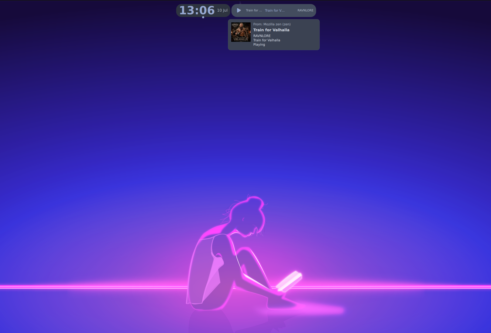

<https://github.com/user-attachments/assets/5ad0ffaf-7cfa-4d5d-90c4-0612791ea183>

#### POTATO fasting

The POTATO fasting pill shows the current fast as a real progress bar, not a tiny terminal cosplay.

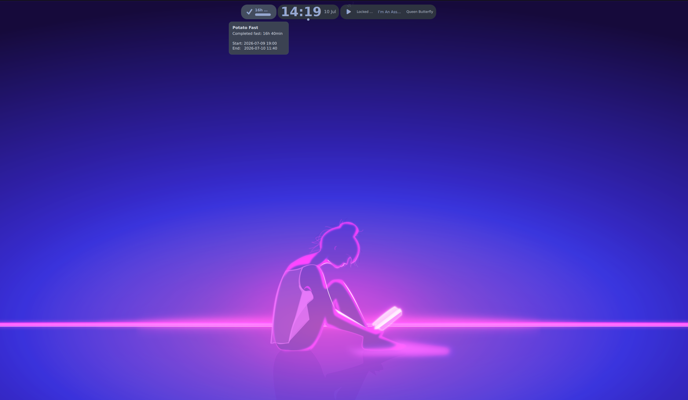

#### Borg backup status

Qreep keeps an eye on Borg backups and can show both the last known state and live progress.

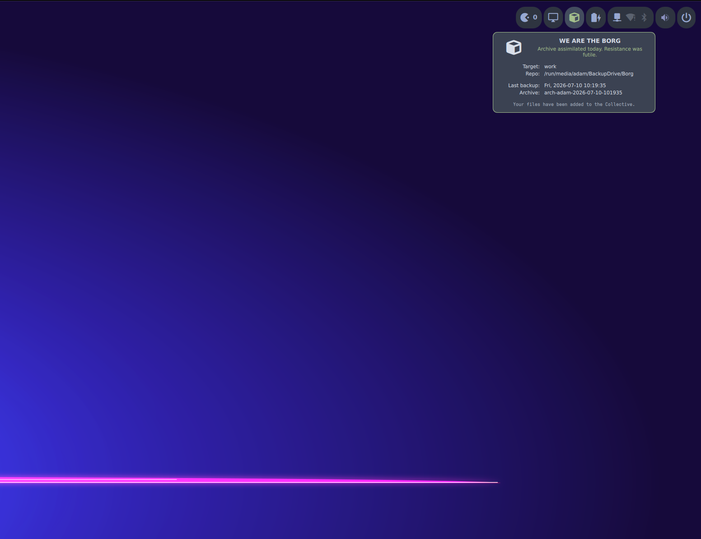

<https://github.com/user-attachments/assets/b59055c3-1343-4cb4-a83b-8c5546354b1e>

#### Monitor profiles

The monitor-profile pill shows the active Hyprland monitor profile and keeps the switcher close by.

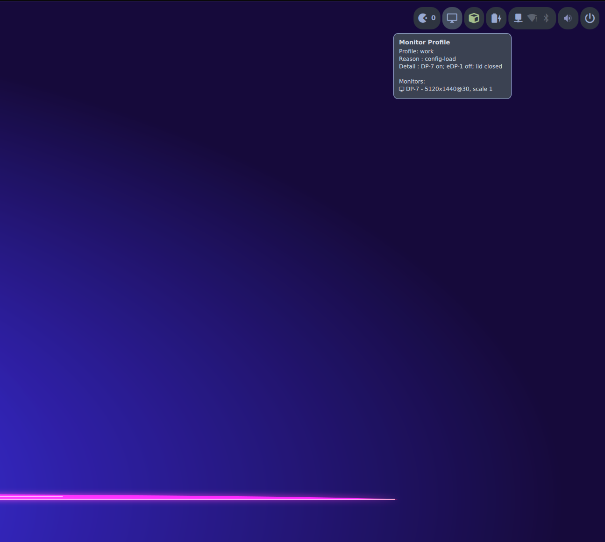

<https://github.com/user-attachments/assets/9e4ecac1-b0f4-4320-a177-f031f07f1c14>

#### Network

Wired networking, Wi-Fi, and Bluetooth share one practical surface.

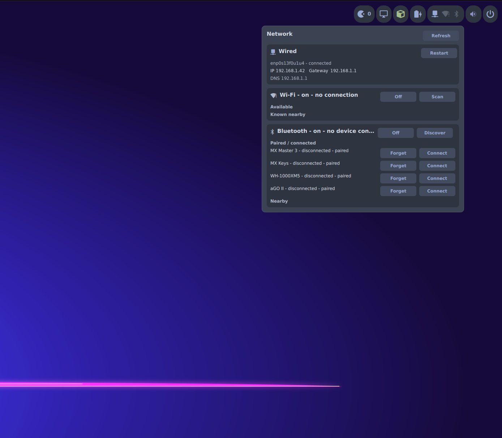

#### Update checker

The bar tooltip gives the quick answer:

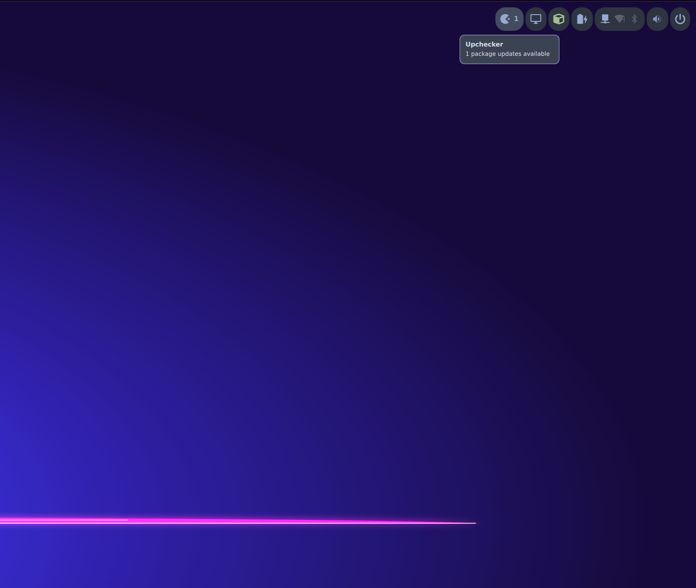

The larger surface handles the less quick answer:

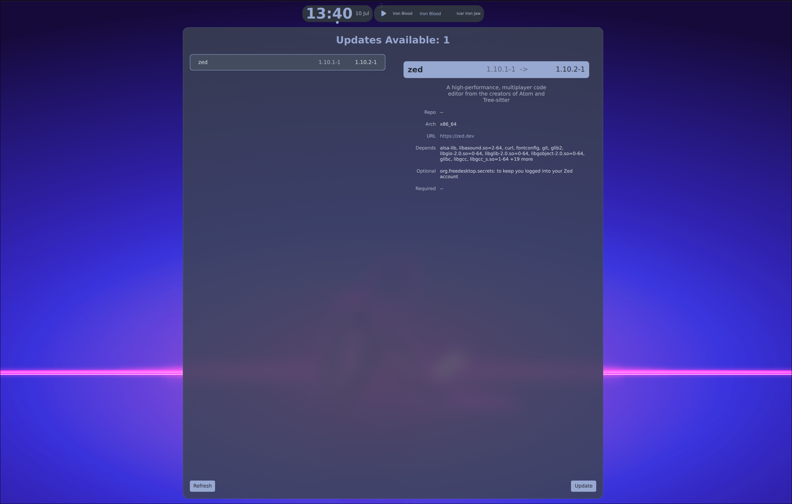

It also shows Triage decisions when they exist and can open the package triage
surface for the selected update.

### Larger shell surfaces

Some things are too large to pretend they are bar widgets:

- **KIP** — the launcher, command line, and local-AI prompt in one box;
- **Places** — a project cockpit: git state, questlog, recent files, then open it where you want;
- **Wallpaper** — the wallpaper picker for Unclaimed Bloom, with colour search;
- **Prism** — colour history, favourites, and palettes, fed by a picker and the clipboard;
- **Screenshot** — select a region, wait, then capture it;
- **Qreeper** — a minimap and Atlas for my MUD mapper;
- **Expose** — a searchable, keyboard-friendly window overview;
- **Clipboard** — clipboard history with search and selection;
- **Fast Password** — a quick password entry picker that authenticates first and only shows allowlisted entries;
- **Notifications** — transient popups and a grouped notification centre;
- **OSD** — quiet on-screen feedback for volume and other shell messages;
- **Polkit** — a Qreep-shaped authentication prompt, real when it owns the session and still demoable when it does not;
- **Timer** — an IPC-opened count-up/countdown panel;
- **Triage** — package inspection and decision notes for Arch maintenance;
- **Dashboard** — a larger surface for useful blocks and experiments;
- **Aegis** — system information and monitoring;
- **Bloom** — progress feedback for my Unclaimed Bloom tooling.

They live as their own modules. The bar is allowed to open them, but it is not allowed to adopt all of them.

#### KIP

KIP opens on `SUPER+SPACE` as an app launcher and turns into whatever the
input asks for: `/ask` and `/notes-ask` talk to a local model through
[Jarvis](tools/jarvis/README.md), `/fd`, `/rg`, `/browse` find files, `/keys`
lists Hyprland binds, `/qreep` drives Qreep's own IPC, and `/help` lists the
rest. It has opinions in its status line. They are mostly correct.

<!-- TODO screenshot: docs/assets/screenshots/qreep-kip.png -->

#### Places

Places shows a project's state before I jump into it — git status,
uncommitted and recent files, questlog, pinned docs, a few numbers — and then
opens it in an editor, the dev cockpit, superfile, or a terminal. Folders,
USB drives, SMB shares, SSH hosts, calendar events, and Logseq TODOs can live
there too, all from one `~/.config/qreep/places.json`.

<!-- TODO screenshot: docs/assets/screenshots/qreep-places.png -->

#### Wallpaper

A grid or list of wallpapers with previews and filtering by name, hex, or CSS
colour name. Picking one hands it to Unclaimed Bloom's `wallset`, which does the
actual theming; Qreep only does the choosing.

<!-- TODO screenshot: docs/assets/screenshots/qreep-wallpaper.png -->

#### Prism

Every colour I pick with `SUPER+P` or copy as `#hex`, `rgb()`, or `hsl()` lands
in a history, with the nearest CSS name. Favourites and palettes of colour
combos sit next to it, plus a hue ring for building harmonies.

<!-- TODO screenshot: docs/assets/screenshots/qreep-prism.png -->

#### Expose

Expose groups windows by workspace, supports searching, and uses real per-window previews so floating windows stop appearing where they were not invited.

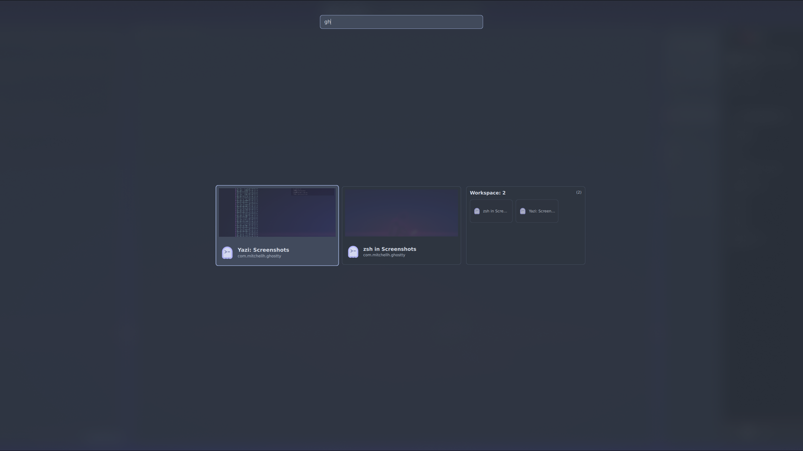

#### Clipboard

The clipboard picker supports text, images, colour values, searching, and keyboard navigation.

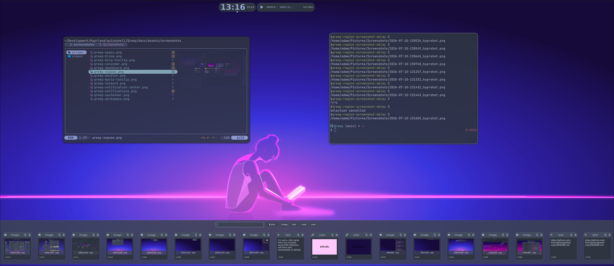

#### Fast Password

Fast Password asks through Qreep Polkit before the chooser opens, then shows only entries allowlisted in `~/.config/qreep/fast-password.json`.

#### Notifications

The notification centre groups notifications by application and keeps actions close enough to be useful.

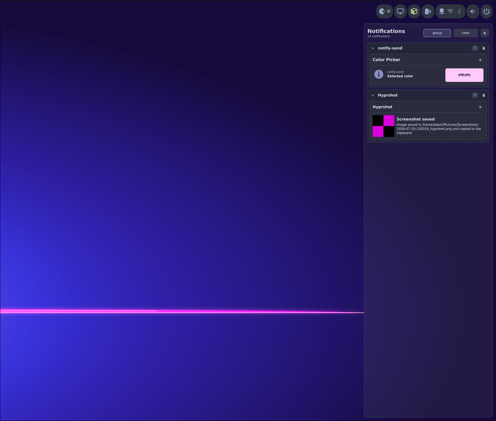

Popups stack under the bar, and a few apps get their own card: Hyprshot brings the screenshot along.

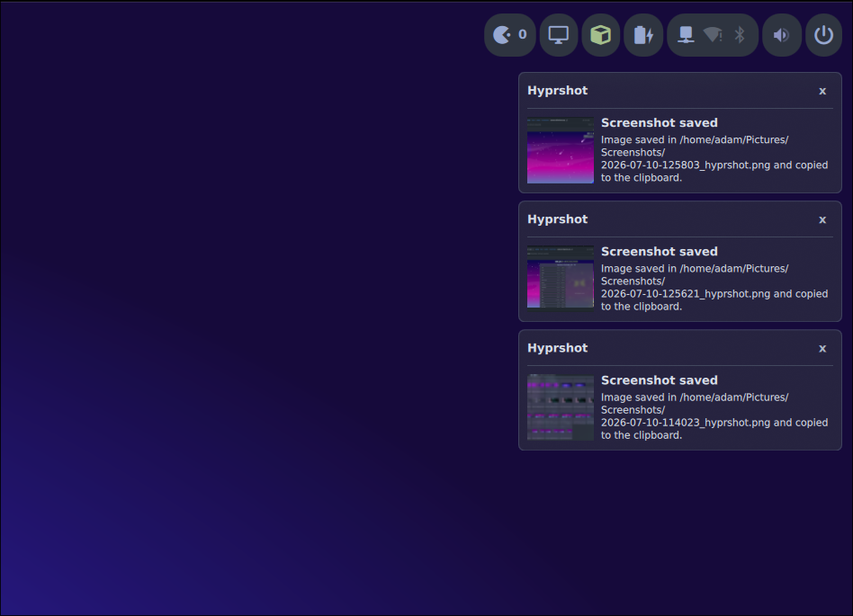

#### Polkit

The Polkit surface can register as the session authentication agent. If `hyprpolkitagent` is already there, Qreep politely loses and the demo command still opens the pretty part without touching root.

#### Dashboard

The dashboard gives larger blocks room to breathe without pretending they belong in a bar popup.

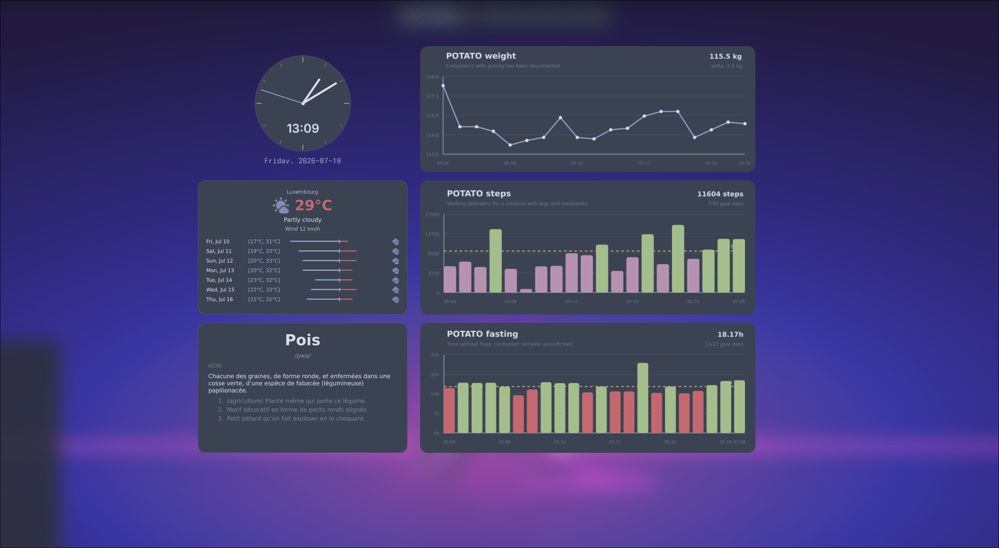

#### Aegis

Aegis collects system, hardware, storage, memory, network, Borg, and Bloom information into one larger surface.

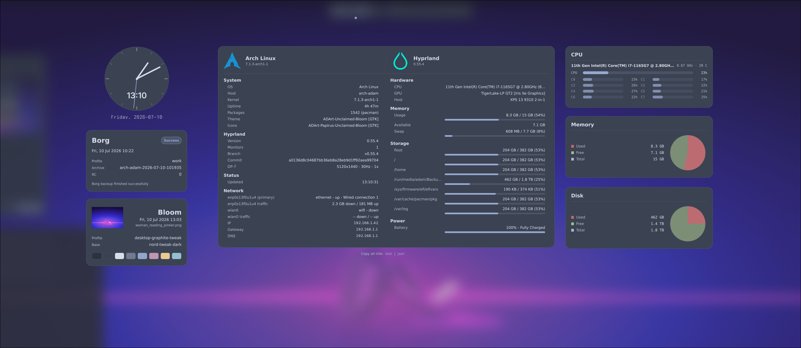

Dashboard and Aegis in motion:

<https://github.com/user-attachments/assets/c17d8637-8525-4d2f-ade9-21c63748ae00>

### A clock that became a calendar

The clock popup grew into a calendar with local events, Google Calendar and Outlook/Microsoft calendar pulls, reminders, event dots, next personal-event hints, and change feedback.

This was not necessarily the plan. It is, however, useful.

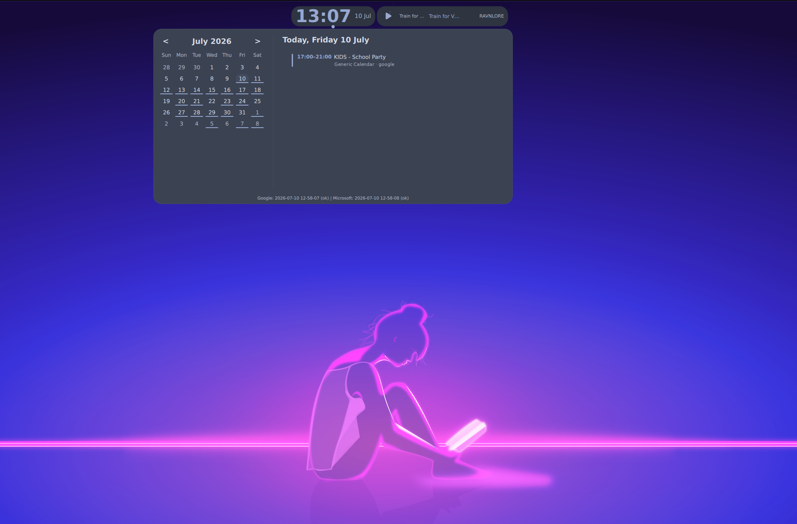

<https://github.com/user-attachments/assets/ad8cf34a-fd57-4501-9b7c-3cd49073d6c7>

### Unclaimed Bloom

Qreep also listens to my [Unclaimed Bloom](https://github.com/Praczet/unclaimed-bloom) tooling and shows progress while the desktop changes its clothes.

<https://github.com/user-attachments/assets/264ad41b-b444-43d1-80a7-9058c3ac9ebe>

## The rules, approximately

Qreep follows a few practical rules:

- useful before universal;
- understandable before clever;
- personal before configurable for every hypothetical computer;
- small controls may live in the bar;
- larger surfaces must earn their own space;
- animations are welcome, provided they do not make the desktop drunk;
- learning is part of the purpose;
- the repository is allowed to grow, but not into a framework with feelings.

## Current condition

Qreep is alive, used, and still changing.

It is a personal configuration rather than a polished drop-in product. You are welcome to inspect it, borrow ideas, reuse pieces, or adapt it to your own desktop. Running the whole thing unchanged may also import several assumptions about my monitor layout, scripts, backups, calendars, and tolerance for animated details.

That seems unfair to both of us.

## Start

Qreep runs from the repository through a symlink, so edits are live after a
restart:

```bash
ln -s ~/Development/Hyprland/quickshell/Qreep ~/.config/quickshell/qreep
```

Install the helper scripts, `triagectl`, and the calendar user units:

```bash
scripts/install
```

That does not cover everything. The Fast Password helpers and their Polkit
policy, and `jarvis`, are installed separately; their READMEs say how.

Run Qreep:

```bash
quickshell -c qreep
```

For relaunching during development without accidentally spawning another copy:

```bash
quickshell -c qreep --no-duplicate
```

It leans on other tools, mostly the obvious ones: Hyprland, `clipvault`,
`wl-clipboard`, `kitty`, `superfile`, `hyprpicker`, `grim` and `slurp`,
`sqlite3`, `ripgrep` and `fd`, `udisks2` and `gvfs`, and Ollama for KIP's
local-AI side. A missing one breaks its own feature, not the shell.

## A few useful IPC calls

```bash
quickshell ipc call qreep-bar setMode reserved
quickshell ipc call qreep-bar setMode overlay
quickshell ipc call qreep-bar setMode collapsed

quickshell ipc call qreep-kip toggle
quickshell ipc call qreep-places toggle
quickshell ipc call qreep-wallpaper toggle
quickshell ipc call qreep-prism pick
quickshell ipc call qreep-expose toggle
quickshell ipc call qreep-clipboard toggle
quickshell ipc call qreep-notification toggleCenter
quickshell ipc call qreep-timer toggle
quickshell ipc call qreep-dashboard toggle
quickshell ipc call qreep-aegis toggle
quickshell ipc call qreep-polkit demo
quickshell ipc call qreep-polkit registrationState
quickshell ipc call qreep-polkit showLog

quickshell ipc call osd showMessage "Qreep lives, somehow" 3000
```

Some Quickshell versions vary slightly in CLI syntax.

When IPC becomes philosophical:

```bash
quickshell ipc --help
```

## Where things live

```text
shell.qml                  top-level shell entry

modules/bar/               the bar
modules/bar/features/      bar-owned pills, services, and popups

modules/aegis/             system dashboard
modules/bloom/             Bloom progress surface
modules/clipboard/         clipboard picker
modules/dashboard/         dashboard engine and surface
modules/expose/            window overview
modules/fastpassword/      Polkit-gated password picker
modules/kip/               launcher, slash commands, local-AI prompt
modules/notification/      notification server, popups, and centre
modules/osd/               on-screen display
modules/places/            project cockpit and other places
modules/polkit/            Polkit auth prompt and demo surface
modules/prism/             colour history, favourites, palettes
modules/qreeper/           Qreeper minimap and Atlas
modules/screenshot/        delayed region screenshots
modules/timer/             timer and countdown panel
modules/triage/            Arch package triage
modules/wallpaper/         wallpaper picker for Unclaimed Bloom

components/                shared UI pieces
core/                      shared shell machinery
theme/                     public theme entry point and tokens
scripts/                   helpers and user services
tools/jarvis/              KIP's local-AI backend
tools/triagectl/           Triage's Rust helper
```

## Documentation

This README is the lobby, not the municipal archive.

For the longer map — module inventory, theme notes, IPC details, layer rules, calendar setup, and the things future Adam will need after pretending he remembers everything — see [`README_when_bored.md`](README_when_bored.md).

## Why “Qreep”?

Because it is odd, small, memorable, slightly cursed, and somehow became mine.

## License

Qreep is free software licensed under the GNU General Public License
version 3 or later (`GPL-3.0-or-later`). See [LICENSE](LICENSE).
